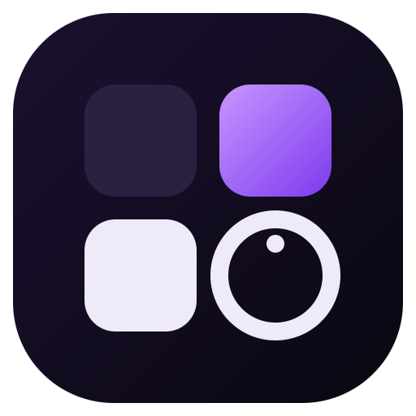

# Noryx

**Turn your Android phone into a stream deck for your PC.** Windows and Linux (KDE Plasma / PipeWire).

> **Public beta.** Noryx is being tested with early users. Things may break — please
> [report bugs](../../issues/new/choose). 🇺🇦 [Українською нижче](#українською).

## What it does

- **Buttons and modes** — launch programs or groups of programs, hotkeys, macros, text typing; your own modes with
  any colour. Script buttons like AutoHotkey: key sequences with pauses, holds, repeat N times or loop.
- **Hotkeys mode** with an on-screen keyboard and numpad.
- **Dock** — master volume and per-app mixer, media player (Spotify / YouTube Music / whatever is playing),
  CPU/GPU load and temperatures, clock.
- **Soundpad** — play sounds "on air" into Discord through a virtual mic.
- **Plugins and mods** from the built-in catalog — Arduino desk lamp, monitor brightness (DDC), Discord,
  Factorio, Satisfactory, Vintage Story, second screen, looks and layouts.
- **Updates itself** from this repository; one tap to roll back.
- Interface in Ukrainian and Russian.

## Install

Download the latest build from **[Releases](../../releases)**.

**Windows 10/11 (64-bit)**
1. Extract `Noryx.zip` to a normal folder, e.g. `C:\Noryx` (not straight from the archive).
2. Run `Start.bat`. The first start downloads what it needs (~1–2 min).
3. If the phone can't connect, run `Firewall.bat` as administrator.

**Linux (KDE Plasma 6, PipeWire)**
1. Extract `Noryx-linux.tar.gz`, e.g. to `~/Noryx`.
2. `cd ~/Noryx && ./start.sh`
3. Optional, for hotkeys: `sudo ./system-setup.sh` once.

**Phone (Android 5+)** — same Wi-Fi as the PC. Install `Noryx.apk` from the PC folder; the app finds the PC by
itself. Or open `http://<PC IP>:8765` in the phone's browser.

More details: `README.txt` in the downloaded folder.

## Privacy and security

Noryx works **only in your local network**. Settings, sounds and logs stay on your PC. New phones must be paired
with a code shown on the PC. The only internet access is checking this repository for updates and the plugin
catalog (and whatever plugins you enable, e.g. Discord). Found a security problem? Please don't open a public
issue — see [SECURITY.md](SECURITY.md).

## License

© Sterben. All rights reserved — see [LICENSE](LICENSE). You may download and use Noryx for free for personal use.
The source code is visible for transparency, but it is **not** open source.

---

## Українською

**Noryx** — стрім-дек на телефоні для твого ПК (Windows і Linux). Зараз — **відкрите бета-тестування**:
щось може не працювати, пиши про це в [Issues](../../issues/new/choose).

**Встановлення:** завантаж збірку з [Releases](../../releases).
Windows — розпакуй `Noryx.zip` у звичайну теку (наприклад `C:\Noryx`) і запусти `Start.bat`.
Linux — розпакуй `Noryx-linux.tar.gz` і запусти `./start.sh`.
Телефон — у тому самому Wi-Fi, встанови `Noryx.apk` з теки на ПК, застосунок сам знайде комп'ютер.
Докладно — `README_UA.txt` у теці.

Дек працює лише у твоїй локальній мережі; налаштування, звуки й логи лишаються на ПК.
Безкоштовно для особистого користування; код відкритий для перегляду, але це **не** open source (див. LICENSE).
